<div align="center">

# DocMind AI

**Inteligência documental com RAG: transforme PDFs em uma base de conhecimento consultável, com respostas fundamentadas e fontes verificáveis (documento + página).**

[](./.github/workflows/ci.yml)


</div>

> Terceiro projeto do portfólio, ao lado do **Nexus CRM** (SaaS comercial) e do **DataFlow Analytics**
> (processamento de dados). O DocMind demonstra arquitetura RAG completa, bancos vetoriais,
> processamento assíncrono de documentos, integração com LLMs e segurança multi-tenant.

---

## Sumário

1. [Problema e solução](#problema-e-solução)
2. [Funcionalidades (Fase 1)](#funcionalidades-fase-1)
3. [Arquitetura](#arquitetura)
4. [Fluxo RAG](#fluxo-rag)
5. [Tecnologias](#tecnologias)
6. [Como executar](#como-executar)
7. [Configuração dos provedores de IA](#configuração-dos-provedores-de-ia)
8. [Testes](#testes)
9. [Segurança](#segurança)
10. [Avaliação do RAG](#avaliação-do-rag)
11. [Limitações atuais](#limitações-atuais)
12. [Deploy](#deploy)
13. [Roadmap](#roadmap)

## Problema e solução

Contratos, políticas, manuais e relatórios são longos, e a busca por palavras falha quando a pergunta
usa termos diferentes dos do arquivo. O DocMind AI indexa o conteúdo por **significado** (embeddings +
pgvector), recupera os trechos relevantes e gera uma resposta **somente a partir deles**, apontando
**documento e página** de cada afirmação. Quando não há evidência, o sistema diz isso em vez de inventar.

```
Pergunta: "Qual é o prazo para cancelamento do contrato?"
Resposta: "O contrato pode ser rescindido mediante aviso prévio de 45 dias [1]…"
Fonte [1]: contrato-prestacao-servicos.pdf — Página 4   ← clicável: abre o PDF na página, com o trecho
```

## Funcionalidades (Fases 1 a 6)

- Cadastro, login, logout; workspace pessoal criado automaticamente; papéis admin/editor/viewer.
- Biblioteca de documentos: upload de **PDF, DOCX e TXT** (drag-and-drop, fila com múltiplos envios), status real de
  processamento (`enviado → validando → extraindo → dividindo em trechos → gerando embeddings → indexando → pronto`),
  **coleções**, **tags**, filtros (status, tipo, coleção, tag), ordenação, renomear, reprocessar, cancelar, excluir,
  histórico de versões de indexação.
- Pipeline próprio: extração por página (pypdf), normalização, chunking com tiktoken, embeddings,
  indexação no pgvector — executado por workers Celery.
- Chat com Documentos: conversas persistentes, escopo por documentos e coleções, **streaming** com fontes
  conhecidas antes do primeiro token e texto final validado, respostas com marcadores `[n]`, bloco de fontes,
  feedback 👍/👎, estados honestos (`sem evidência`, `IA indisponível`), painel **"Como esta resposta foi gerada"**
  (candidatos, scores, contexto, citações, latência e tokens), busca e organização do histórico.
- Visualizador PDF.js lado a lado com o chat: ao clicar na fonte abre a página certa e destaca o
  trecho quando ele é localizado com exatidão (caso contrário mostra o trecho no painel). Para DOCX/TXT, um
  visualizador de texto por **seções** (sem páginas inventadas) com destaque do trecho citado.
- Pesquisa **híbrida** (pgvector + Full-Text Search do PostgreSQL com fusão RRF) independente do chat, com scores
  vetorial e léxico por resultado, destaque dos termos e histórico de pesquisas.
- **Inteligência documental**: resumos em 6 tipos com estratégia hierárquica para documentos longos, comparação
  entre 2–5 documentos com evidências rotuladas (A, B…), extração de tópicos, perguntas sugeridas e exportação de
  análises e conversas em Markdown/JSON. Toda análise traz fontes, cobertura (trechos lidos/total, estratégia) e
  limitações geradas pelo backend.
- **Administração e segurança**: múltiplos workspaces por usuário, convites por e-mail/link, papéis admin/editor/viewer
  com matriz aplicada no backend, limites de uso e custo por workspace, uso por usuário e por dia, auditoria consultável e
  exportável, políticas de retenção automáticas, recuperação e alteração de senha, sessões ativas, escolha de modelo
  entre os permitidos e OCR opcional (Tesseract) após avaliação técnica.
- **Avaliação e qualidade**: módulo de avaliação RAG reproduzível (43 perguntas anotadas, Recall@K, citações válidas,
  sustentação, abstenção, testes adversariais, latência, tokens, custo) com relatório versionado; suíte E2E Playwright;
  revisão de segurança documentada; CI com lint, testes, auditoria de dependências, build das imagens e E2E.
- Configurações: perfil, workspace, membros, status/aviso de privacidade da IA, uso e limites, **parâmetros de
  recuperação por workspace** (modo, top_k, limiar, contexto) editáveis por administradores, tema claro/escuro.
- Controle de uso: limites de perguntas/uploads por hora, tamanho e páginas por arquivo, tokens de contexto e saída.

## Screenshots

Capturadas automaticamente pela suíte E2E (`e2e/screenshots.spec.ts`) contra a stack Docker com documentos fictícios.

| | |
|---|---|
| 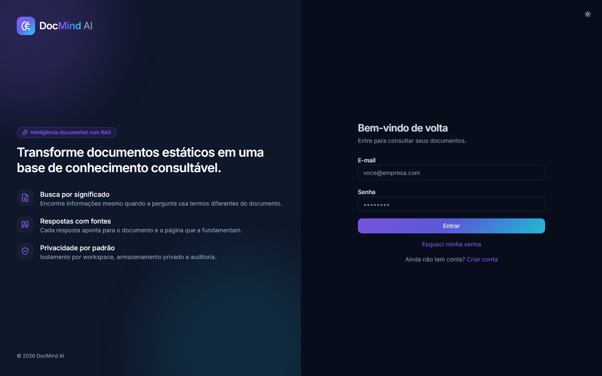 | 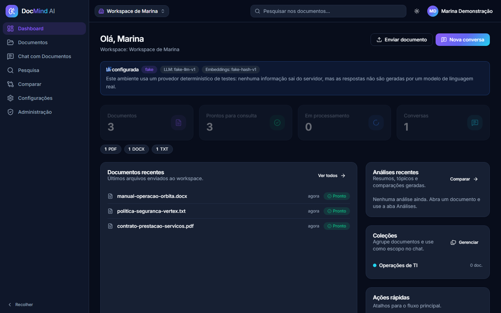 |
| 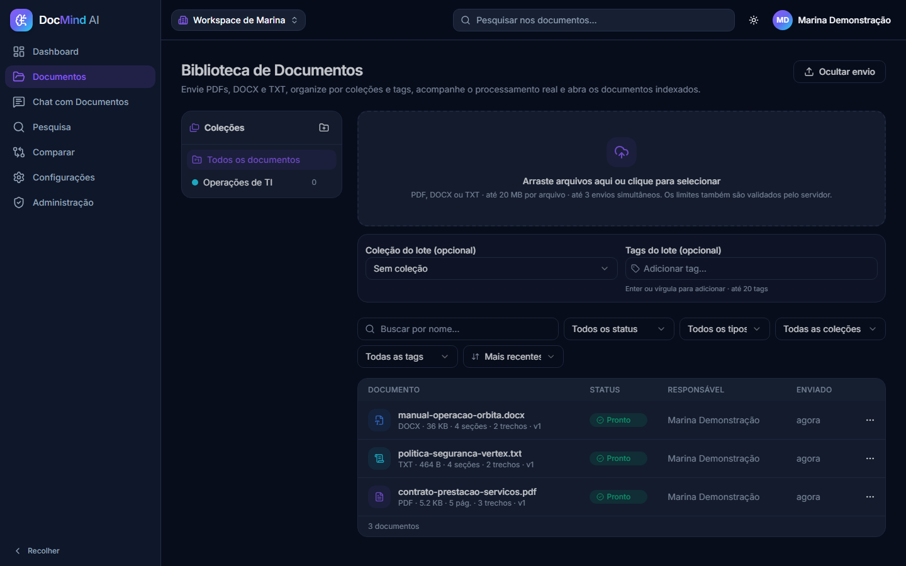 | 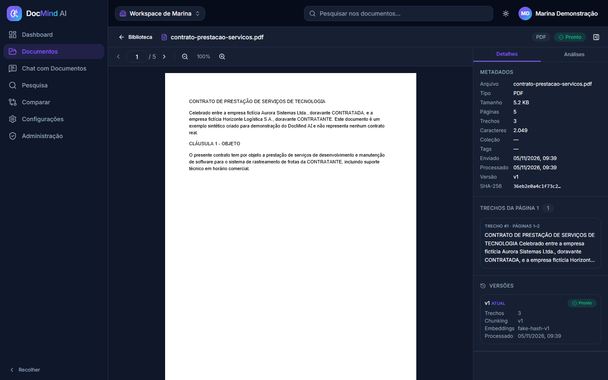 |
| 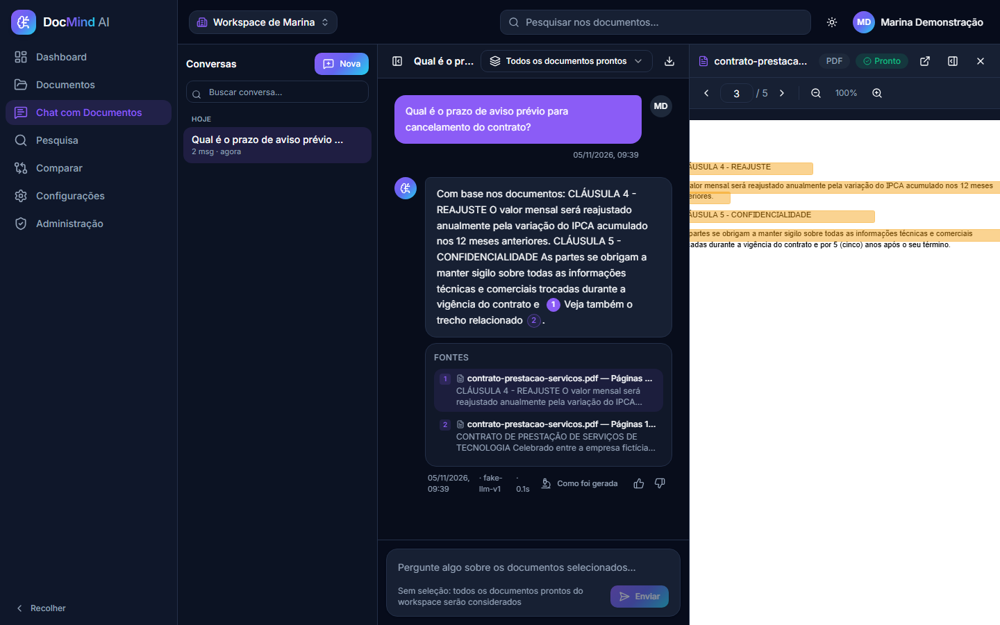 | 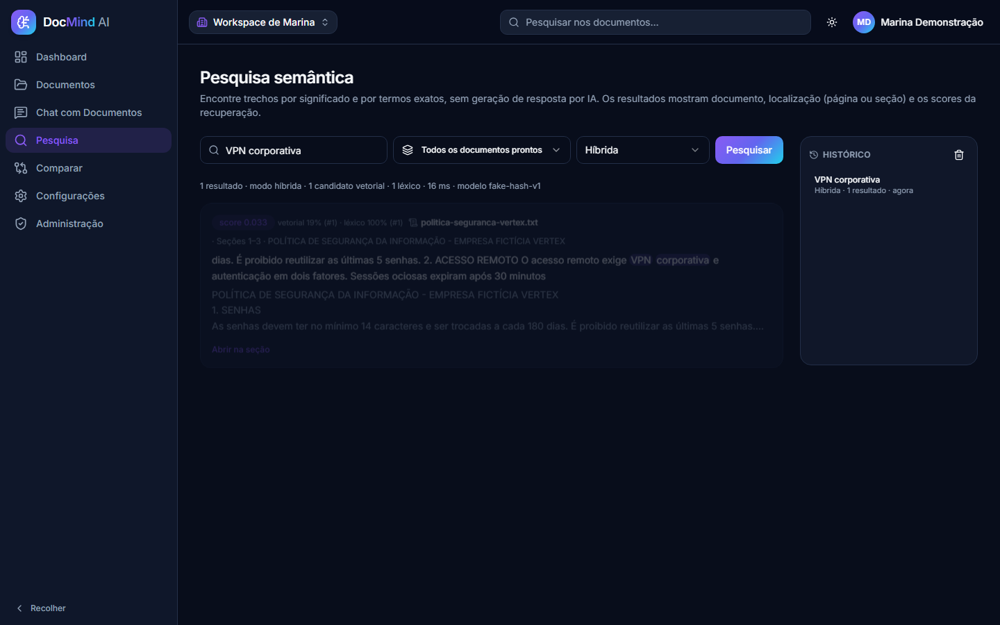 |
| 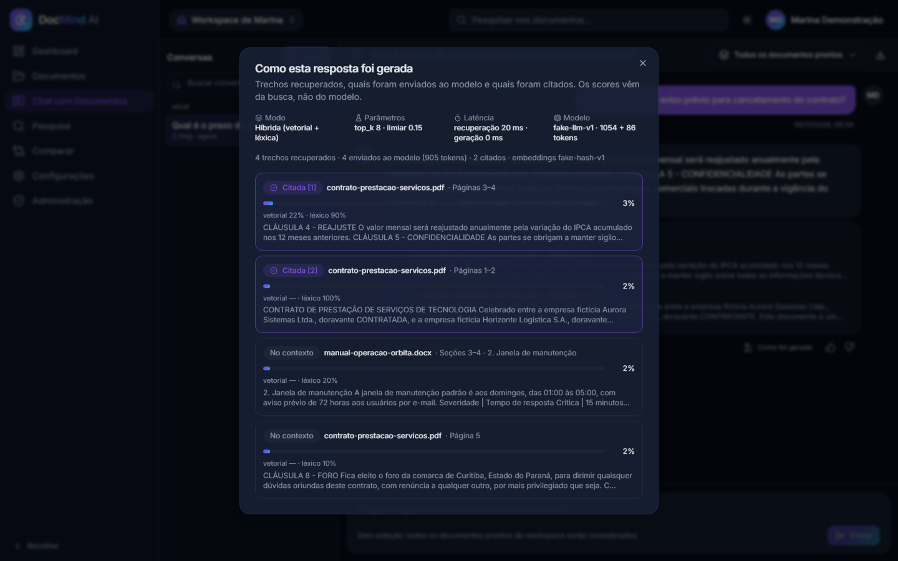 | 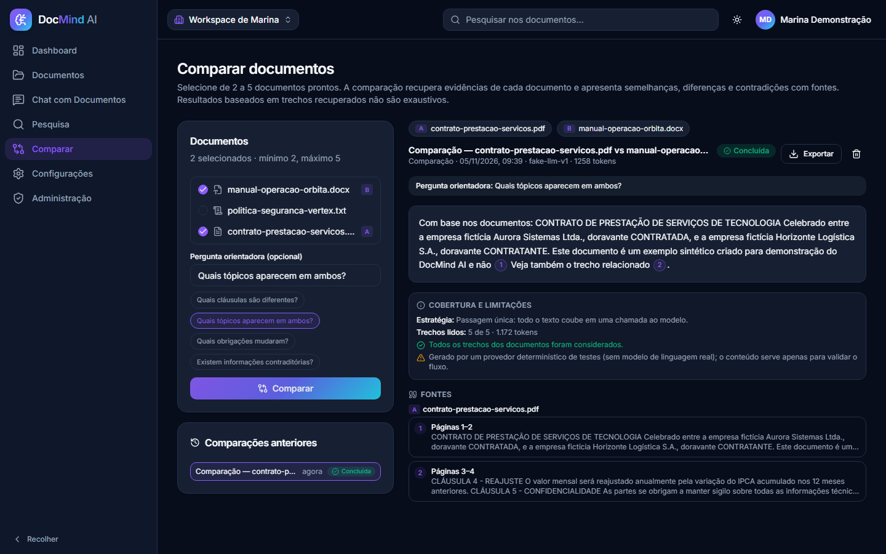 |
| 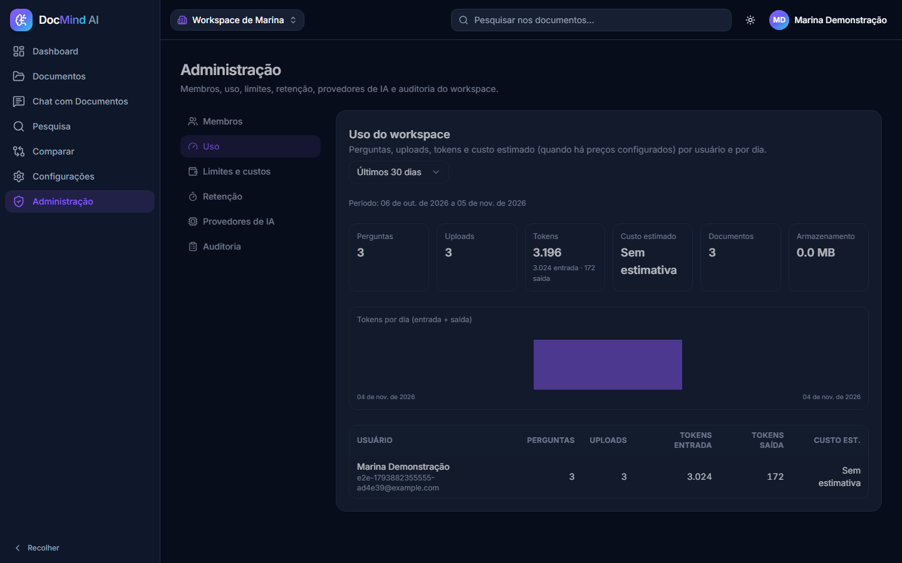 | 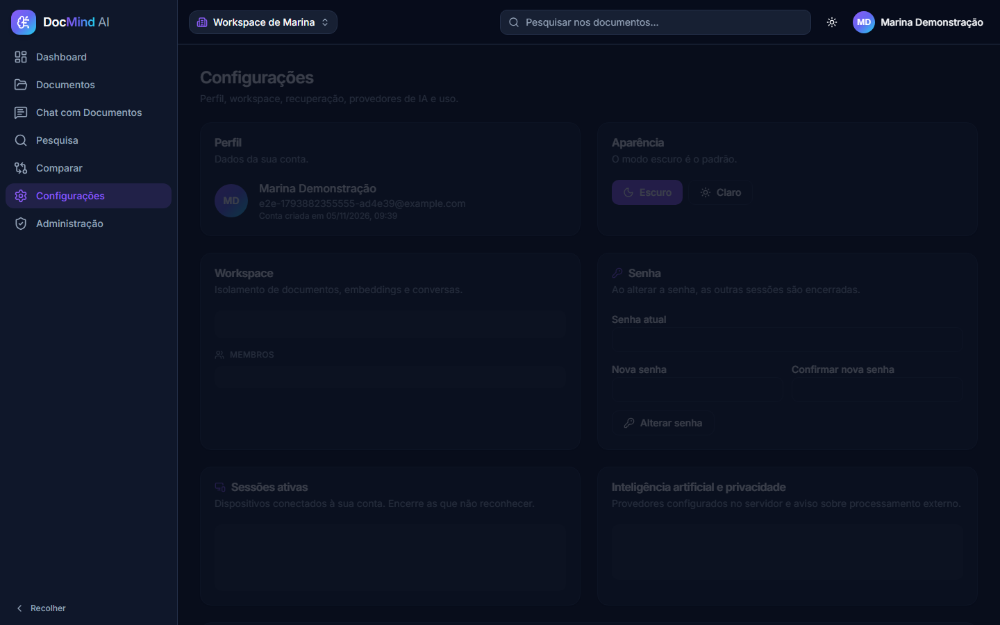 |

## Demonstração

O modo demonstração (`DEMO_MODE=true`) prepara o DocMind para visitantes: aviso fixo de ambiente de demonstração,
cadastro com workspace isolado e limitado por visitante, teto diário global de tokens que protege a quota da chave e
um botão "Carregar documentos de exemplo" com os arquivos fictícios de `samples/`. A publicação num servidor Linux é
um comando, com HTTPS automático (domínio próprio ou `<ip>.sslip.io`):

```bash
sudo ./deploy/bootstrap.sh --sslip        # ou --domain demo.seu-dominio.com
```

Passo a passo, backup e limitações em [docs/deploy.md](docs/deploy.md#demo-pública). Sem chave de provedor
(`--fake`), a interface deixa claro que as respostas vêm de um provedor determinístico de testes.

## Arquitetura

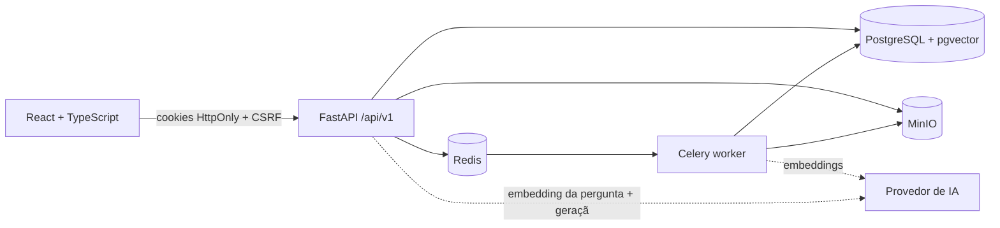

Detalhes em [docs/architecture.md](docs/architecture.md). Decisões em [docs/decisions.md](docs/decisions.md).

## Fluxo RAG

```
PDF → validação → MinIO → extração por página → normalização → chunking (700/900 tokens, overlap 100,
quebra por página) → embeddings → pgvector → pronto

pergunta → autenticação/escopo → embedding → busca vetorial (cosseno) + busca textual (tsvector) → fusão RRF →
contexto delimitado (≤ 6000 tokens) → LLM (streaming opcional) → validação estrutural das citações → resposta + fontes
```

Cada etapa é um módulo em `backend/app/rag/` e está explicada em [docs/rag-pipeline.md](docs/rag-pipeline.md).

## Tecnologias

| Camada | Stack |
|---|---|
| Frontend | React 19, TypeScript, Vite 7, Tailwind CSS 4, componentes estilo shadcn/ui (Radix), React Router 7, TanStack Query 5, React Hook Form + Zod, Lucide, PDF.js (`pdfjs-dist`) |
| Backend | Python 3.13, FastAPI, Pydantic 2, SQLAlchemy 2, Alembic, psycopg 3, pgvector, Celery, Redis, Argon2id, structlog |
| Processamento | pypdf, python-docx, charset_normalizer, tiktoken, chunking e metadados próprios |
| IA | Camada de adaptadores (`providers/`): **Google Gemini** (`google-genai`: `gemini-embedding-001` + `gemini-3.5-flash-lite`, padrão), OpenAI ou provedores determinísticos para testes; modelos por variáveis de ambiente |
| Infra | Docker Compose (pgvector/pg17, Redis 7, MinIO, API, worker, web), Caddy (produção), GitHub Actions |
| Testes | Pytest (156 testes), Vitest + Testing Library (111 testes), Playwright E2E (8 testes + screenshots) |

## Como executar

### Com Docker Compose (recomendado)

```bash
git clone <repo> docmind-ai && cd docmind-ai
cp .env.example .env     # defina SECRET_KEY e GEMINI_API_KEY (ou EMBEDDING_PROVIDER/LLM_PROVIDER=fake)
docker compose up --build
```

- Frontend: http://localhost:5173
- API + OpenAPI: http://localhost:8000/api/docs
- MinIO console: http://localhost:9001

Documentos fictícios para teste: `samples/` (ver [samples/README.md](samples/README.md)).
Smoke test de ponta a ponta contra a instância: `cd backend && uv run python ../scripts/smoke_test.py`.

### Sem Docker (desenvolvimento)

Ver [docs/deploy.md](docs/deploy.md): PGlite + pgvector local (`scripts/pglite`), API com
`STORAGE_BACKEND=local` e `CELERY_TASK_ALWAYS_EAGER=true`, frontend com `pnpm dev`.

## Configuração dos provedores de IA

| Variável | Descrição |
|---|---|
| `EMBEDDING_PROVIDER` / `LLM_PROVIDER` | `gemini` (Google Gemini API, padrão), `openai` ou `fake` (determinístico; só desenvolvimento/testes). Embeddings e geração precisam **ambos** de chave para a IA constar como configurada |
| `GEMINI_API_KEY` | chave da Gemini API, criada em [Google AI Studio](https://aistudio.google.com/app/apikey); lida só pelo backend (`api` e `worker`), nunca vai para o frontend nem para o repositório |
| `OPENAI_API_KEY` | só com `*_PROVIDER=openai` |
| `EMBEDDING_MODEL`, `EMBEDDING_DIMENSIONS` | `gemini-embedding-001` com `1536` dimensões (coluna `vector(1536)` do pgvector); trocar modelo ou dimensão exige reindexar (`python -m app.rag.embeddings.reindex`) |
| `LLM_MODEL`, `LLM_ALLOWED_MODELS` | `gemini-3.5-flash-lite` por padrão; modelos que administradores podem escolher por workspace |
| `LLM_TIMEOUT_SECONDS`, `LLM_MAX_RETRIES`, `PROVIDER_RETRY_*` | timeout e retentativas com backoff exponencial + jitter para 429/5xx/rede (nunca infinitas) |
| `GEMINI_THINKING_LEVEL`, `GEMINI_APPLY_TEMPERATURE` | nível de raciocínio (vazio = padrão do modelo) e se a temperatura da aplicação é enviada (padrão: não, como a Google recomenda para Gemini 3) |
| `PRICE_*_PER_1M` | opcional; sem valores, o sistema **não** exibe custo estimado |

**Nível gratuito do Gemini**: a chave do AI Studio funciona sem cartão, com limites por minuto e por dia por
projeto (visíveis no próprio AI Studio) e, nesse nível, o Google pode usar o conteúdo enviado para melhorar seus
produtos — a interface mostra esse aviso. Quando o limite é atingido, o DocMind informa que o limite do provedor
foi alcançado e que o processamento poderá ser tentado mais tarde; ele **não** migra para modelos pagos nem ativa
faturamento. Passo a passo e procedimento de reindexação em [docs/deploy.md](docs/deploy.md#google-gemini-chave-nível-gratuito-e-reindexação).

Sem chave configurada, a interface informa que a geração com IA está indisponível; nada é simulado como
resposta real. A tela de configurações mostra o aviso de que trechos (não arquivos inteiros) podem ser
enviados ao provedor externo, e o workspace pode desativar o processamento externo.

## Testes

```bash
# backend — precisa de PostgreSQL+pgvector (TEST_DATABASE_URL); sem ele, os de integração são pulados
cd backend && uv sync && uv run pytest

# frontend
cd apps/web && pnpm install && pnpm test

# E2E (com a stack Docker no ar; ver e2e/README.md)
cd e2e && pnpm install && pnpm exec playwright install chromium && pnpm test
```

O que é coberto: autenticação, CSRF, isolamento entre workspaces (API, download, chunks e busca
vetorial), uploads inválidos (extensão falsa, excesso de tamanho, duplicados, criptografados, sem texto),
extração, normalização, chunking (limites, sobreposição, páginas), embeddings determinísticos,
recuperação com página correta, citações válidas/ inválidas, abstenção, prompt injection em documento,
limites de uso, feedback e histórico. Detalhes em [docs/evaluation.md](docs/evaluation.md).

## Segurança

Revisão de segurança da Fase 6 em [docs/security-review.md](docs/security-review.md). Argon2id, sessões no servidor, cookies HttpOnly, CSRF double-submit validado contra a sessão, rate
limiting, RBAC, isolamento por workspace em todas as consultas (inclusive vetoriais), validação de
assinatura e limites de upload, nomes internos aleatórios, downloads autenticados, documentos tratados
como dados não confiáveis (sem ferramentas para o modelo). Ver [docs/security.md](docs/security.md).

## Avaliação do RAG

`python -m app.rag.evaluation` roda um dataset de **43 perguntas anotadas** (diretas, por página, cruzando documentos,
nomes semelhantes, contradições, sem resposta, maliciosas e com escopo restrito) sobre cinco documentos sintéticos e
gera um relatório versionado em [docs/evaluation/latest.md](docs/evaluation/latest.md) com Recall@K/Precision@K/MRR,
citações válidas e relevantes, sustentação pelas fontes (juiz declarado), abstenção correta, perguntas maliciosas
obedecidas, latência, tokens e custo. Rodada real com **Google Gemini** (05/11/2026, nível gratuito): Recall@K 1.0,
MRR 0.90, 100% das respostas com citações válidas, abstenção em 100% das perguntas sem resposta, 0 instruções
maliciosas obedecidas, sustentação pelas fontes de 81% segundo juiz LLM (autoavaliação, sujeito a erro) e latência
mediana de 1,7 s. A rodada com o provedor determinístico `fake` fica preservada como baseline da **mecânica** do
pipeline. Leitura detalhada, limitações e o que a primeira rodada ensinou em [docs/evaluation.md](docs/evaluation.md).
Nenhuma nota é publicada sem execução reproduzível.

## Limitações atuais

- PDF precisa ter camada de texto (OCR avaliado na Fase 5); DOCX/TXT são exibidos como texto extraído, sem a formatação original.
- Chunks de ~700 tokens: em documentos curtos a citação pode cobrir um intervalo de páginas.
- Sem reranker neural: a relevância híbrida usa RRF determinístico; parâmetros serão ajustados com a avaliação da Fase 6.
- O provedor `fake` serve para testar a mecânica; a qualidade das respostas depende de um LLM real.
- Validação de citações é estrutural; sustentação factual será medida na Fase 6.

## Deploy

`docker-compose.prod.yml` + Caddy com HTTPS automático (`SITE_ADDRESS`), `deploy/bootstrap.sh` para servidores Ubuntu/Debian e `deploy/backup.sh` para backups. Checklist e variáveis em [docs/deploy.md](docs/deploy.md).

## Roadmap

| Fase | Escopo | Status |
|---|---|---|
| 1 | Fundação e RAG funcional (PDF → chat com citações) | ✅ concluída e validada com a stack Docker completa |
| 2 | Biblioteca documental: DOCX/TXT, coleções, tags, versionamento | ✅ concluída e validada com a stack Docker |
| 3 | Busca híbrida, streaming, configurações de recuperação | ✅ concluída e validada com a stack Docker |
| 4 | Resumos hierárquicos, comparação entre documentos, exportação | ✅ concluída e validada com a stack Docker |
| 5 | Administração, limites de custo, auditoria, retenção, OCR | ✅ concluída e validada com a stack Docker |
| 6 | Avaliação RAG, E2E, benchmark, revisão de segurança, demo pública | ✅ concluída (demo pública depende de hospedagem do autor) |

Acompanhamento detalhado em [PROGRESS.md](PROGRESS.md).
