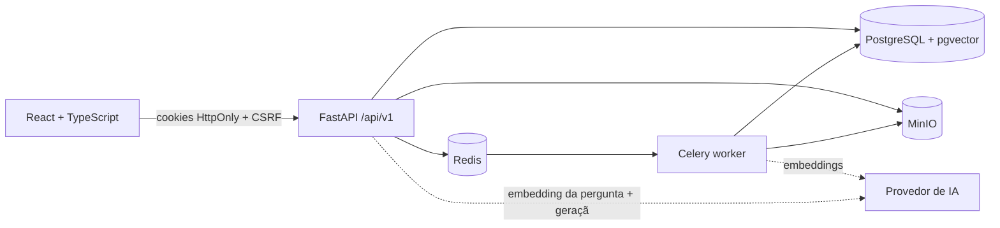

<div align="center">

# DocMind AI

**Inteligência documental com RAG: transforme PDFs em uma base de conhecimento consultável, com respostas fundamentadas e fontes verificáveis (documento + página).**

[](./.github/workflows/ci.yml)


</div>

> Terceiro projeto do portfólio, ao lado do **Nexus CRM** (SaaS comercial) e do **DataFlow Analytics**
> (processamento de dados). O DocMind demonstra arquitetura RAG completa, bancos vetoriais,
> processamento assíncrono de documentos, integração com LLMs e segurança multi-tenant.

---

## Sumário

1. [Problema e solução](#problema-e-solução)
2. [Funcionalidades (Fase 1)](#funcionalidades-fase-1)
3. [Arquitetura](#arquitetura)
4. [Fluxo RAG](#fluxo-rag)
5. [Tecnologias](#tecnologias)
6. [Como executar](#como-executar)
7. [Configuração dos provedores de IA](#configuração-dos-provedores-de-ia)
8. [Testes](#testes)
9. [Segurança](#segurança)
10. [Avaliação do RAG](#avaliação-do-rag)
11. [Limitações atuais](#limitações-atuais)
12. [Deploy](#deploy)
13. [Roadmap](#roadmap)

## Problema e solução

Contratos, políticas, manuais e relatórios são longos, e a busca por palavras falha quando a pergunta
usa termos diferentes dos do arquivo. O DocMind AI indexa o conteúdo por **significado** (embeddings +
pgvector), recupera os trechos relevantes e gera uma resposta **somente a partir deles**, apontando
**documento e página** de cada afirmação. Quando não há evidência, o sistema diz isso em vez de inventar.

```
Pergunta: "Qual é o prazo para cancelamento do contrato?"
Resposta: "O contrato pode ser rescindido mediante aviso prévio de 45 dias [1]…"
Fonte [1]: contrato-prestacao-servicos.pdf — Página 4   ← clicável: abre o PDF na página, com o trecho
```

## Funcionalidades (Fase 1)

- Cadastro, login, logout; workspace pessoal criado automaticamente; papéis admin/editor/viewer.
- Biblioteca de documentos: upload de PDF (drag-and-drop, múltiplos), status real de processamento
  (`enviado → validando → extraindo → dividindo em trechos → gerando embeddings → indexando → pronto`),
  busca, filtro por status, reprocessamento, exclusão.
- Pipeline próprio: extração por página (pypdf), normalização, chunking com tiktoken, embeddings,
  indexação no pgvector — executado por workers Celery.
- Chat com Documentos: conversas persistentes, seleção de documentos, respostas com marcadores `[n]`,
  bloco de fontes, feedback 👍/👎, estados honestos (`sem evidência`, `IA indisponível`).
- Visualizador PDF.js lado a lado com o chat: ao clicar na fonte abre a página certa e destaca o
  trecho quando ele é localizado com exatidão (caso contrário mostra o trecho no painel).
- Pesquisa semântica independente do chat (lista de trechos com score, documento e página).
- Configurações: perfil, workspace, membros, status/aviso de privacidade da IA, uso e limites, tema claro/escuro.
- Controle de uso: limites de perguntas/uploads por hora, tamanho e páginas por arquivo, tokens de contexto e saída.

## Arquitetura



Detalhes em [docs/architecture.md](docs/architecture.md). Decisões em [docs/decisions.md](docs/decisions.md).

## Fluxo RAG

```
PDF → validação → MinIO → extração por página → normalização → chunking (700/900 tokens, overlap 100,
quebra por página) → embeddings → pgvector → pronto

pergunta → autenticação/escopo → embedding → busca cosseno filtrada por workspace/documentos/modelo →
contexto delimitado (≤ 6000 tokens) → LLM → validação estrutural das citações → resposta + fontes
```

Cada etapa é um módulo em `backend/app/rag/` e está explicada em [docs/rag-pipeline.md](docs/rag-pipeline.md).

## Tecnologias

| Camada | Stack |
|---|---|
| Frontend | React 19, TypeScript, Vite 7, Tailwind CSS 4, componentes estilo shadcn/ui (Radix), React Router 7, TanStack Query 5, React Hook Form + Zod, Lucide, PDF.js (`pdfjs-dist`) |
| Backend | Python 3.13, FastAPI, Pydantic 2, SQLAlchemy 2, Alembic, psycopg 3, pgvector, Celery, Redis, Argon2id, structlog |
| Processamento | pypdf, tiktoken, chunking e metadados próprios |
| IA | Camada de adaptadores (`providers/`): OpenAI (embeddings + chat) ou provedores determinísticos para testes; modelos por variáveis de ambiente |
| Infra | Docker Compose (pgvector/pg17, Redis 7, MinIO, API, worker, web), Caddy (produção), GitHub Actions |
| Testes | Pytest (53 testes), Vitest + Testing Library (28 testes), Playwright (Fase 6) |

## Como executar

### Com Docker Compose (recomendado)

```bash
git clone <repo> docmind-ai && cd docmind-ai
cp .env.example .env     # defina SECRET_KEY e, se tiver, OPENAI_API_KEY
docker compose up --build
```

- Frontend: http://localhost:5173
- API + OpenAPI: http://localhost:8000/api/docs
- MinIO console: http://localhost:9001

Documentos fictícios para teste: `samples/` (ver [samples/README.md](samples/README.md)).
Smoke test de ponta a ponta contra a instância: `cd backend && uv run python ../scripts/smoke_test.py`.

### Sem Docker (desenvolvimento)

Ver [docs/deploy.md](docs/deploy.md): PGlite + pgvector local (`scripts/pglite`), API com
`STORAGE_BACKEND=local` e `CELERY_TASK_ALWAYS_EAGER=true`, frontend com `pnpm dev`.

## Configuração dos provedores de IA

| Variável | Descrição |
|---|---|
| `EMBEDDING_PROVIDER` / `LLM_PROVIDER` | `openai` (real) ou `fake` (determinístico; só desenvolvimento/testes) |
| `OPENAI_API_KEY` | chave do provedor (nunca vai para o frontend nem para o repositório) |
| `EMBEDDING_MODEL`, `EMBEDDING_DIMENSIONS` | modelo e dimensão do vetor; trocar exige reindexação |
| `LLM_MODEL`, `LLM_TIMEOUT_SECONDS`, `LLM_MAX_RETRIES` | geração |
| `PRICE_*_PER_1M` | opcional; sem valores, o sistema **não** exibe custo estimado |

Sem chave configurada, a interface informa que a geração com IA está indisponível; nada é simulado como
resposta real. A tela de configurações mostra o aviso de que trechos (não arquivos inteiros) podem ser
enviados ao provedor externo, e o workspace pode desativar o processamento externo.

## Testes

```bash
# backend — precisa de PostgreSQL+pgvector (TEST_DATABASE_URL); sem ele, os de integração são pulados
cd backend && uv sync && uv run pytest

# frontend
cd apps/web && pnpm install && pnpm test
```

O que é coberto: autenticação, CSRF, isolamento entre workspaces (API, download, chunks e busca
vetorial), uploads inválidos (extensão falsa, excesso de tamanho, duplicados, criptografados, sem texto),
extração, normalização, chunking (limites, sobreposição, páginas), embeddings determinísticos,
recuperação com página correta, citações válidas/ inválidas, abstenção, prompt injection em documento,
limites de uso, feedback e histórico. Detalhes em [docs/evaluation.md](docs/evaluation.md).

## Segurança

Argon2id, sessões no servidor, cookies HttpOnly, CSRF double-submit validado contra a sessão, rate
limiting, RBAC, isolamento por workspace em todas as consultas (inclusive vetoriais), validação de
assinatura e limites de upload, nomes internos aleatórios, downloads autenticados, documentos tratados
como dados não confiáveis (sem ferramentas para o modelo). Ver [docs/security.md](docs/security.md).

## Avaliação do RAG

A Fase 1 entrega a base: documentos sintéticos com fatos em páginas conhecidas, provedores
determinísticos e testes que verificam recuperação, citação e abstenção. O conjunto com ≥ 30 perguntas,
métricas (Recall@K, citações válidas, sustentação factual, abstenção correta, latência, tokens, custo) e
relatório reproduzível vem na Fase 6. **Nenhuma nota de qualidade é publicada sem esses testes.**

## Limitações atuais

- Apenas PDF com camada de texto (DOCX/TXT na Fase 2; OCR avaliado na Fase 5).
- Chunks de ~700 tokens: em documentos curtos a citação pode cobrir um intervalo de páginas.
- Busca apenas vetorial (híbrida com Full-Text Search na Fase 3); sem streaming de respostas.
- O provedor `fake` serve para testar a mecânica; a qualidade das respostas depende de um LLM real.
- Validação de citações é estrutural; sustentação factual será medida na Fase 6.

## Deploy

`docker-compose.prod.yml` + Caddy. Checklist e variáveis em [docs/deploy.md](docs/deploy.md).

## Roadmap

| Fase | Escopo | Status |
|---|---|---|
| 1 | Fundação e RAG funcional (PDF → chat com citações) | ✅ concluída e validada com a stack Docker completa |
| 2 | Biblioteca documental: DOCX/TXT, coleções, tags, versionamento | ⏳ |
| 3 | Busca híbrida, streaming, configurações de recuperação | ⏳ |
| 4 | Resumos hierárquicos, comparação entre documentos, exportação | ⏳ |
| 5 | Administração, limites de custo, auditoria, retenção, OCR | ⏳ |
| 6 | Avaliação RAG, E2E, benchmark, revisão de segurança, demo pública | ⏳ |

Acompanhamento detalhado em [PROGRESS.md](PROGRESS.md).
