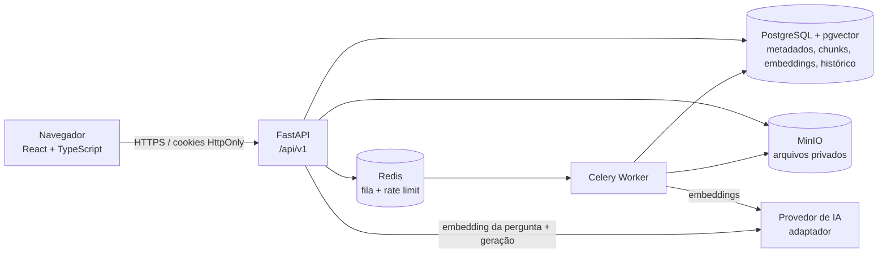

# Arquitetura — DocMind AI

## Visão geral



PostgreSQL e pgvector são um único serviço (`pgvector/pgvector:pg17`). O diagrama separa
responsabilidades, não processos.

## Camadas do backend

| Camada | Pasta | Responsabilidade |
|---|---|---|
| HTTP | `backend/app/api/` | Validação de entrada (Pydantic), autenticação/CSRF, serialização. Sem regra de negócio. |
| Serviços | `backend/app/services/` | Regras de negócio: auth, documentos, pipeline de processamento, chat, uso, auditoria. |
| RAG | `backend/app/rag/` | `extraction/`, `chunking/`, `embeddings/`, `retrieval/`, `generation/`, `evaluation/`. Cada etapa é independente e testável. |
| Provedores | `backend/app/providers/` | Adaptadores: `storage` (MinIO/local/memória), `embeddings` e `llm` (interfaces), `gemini` (Google Gemini API via `google-genai`: embeddings com tipos de tarefa + geração/streaming), OpenAI e `fake` (testes), `errors` (erros de provedor normalizados: quota, credencial, modelo, timeout, bloqueio), `tokens`, `redis_client`. A chave do provedor existe só no ambiente de `api` e `worker`. |
| Modelos | `backend/app/models/` | SQLAlchemy 2 (UUIDs, timestamps, soft delete). Migrations em `backend/migrations/`. |
| Workers | `backend/app/workers/` | Celery: tarefa `documents.process` com retentativas e backoff. |

### Regras transversais

- O `workspace_id` **nunca** vem do cliente: é resolvido a partir da sessão (`AuthContext`).
- Toda consulta a documentos, chunks, embeddings, conversas e mensagens filtra por `workspace_id`.
  Chunks e embeddings carregam `workspace_id` desnormalizado para que a busca vetorial seja
  filtrada diretamente na tabela de vetores.
- Erros seguem um único formato (`{"error": {code, message, details}}`), ver `core/exceptions.py`.
- Logs estruturados (structlog) nunca incluem conteúdo de documentos, perguntas ou chaves.

## Frontend

`apps/web` (Vite + React 19 + TypeScript strict + Tailwind v4 + componentes no estilo shadcn/ui).

- `src/services/api.ts`: cliente HTTP com `credentials: include` e header `X-CSRF-Token`.
- `src/features/*`: hooks TanStack Query + componentes por domínio (auth, documents, chat, search, settings).
- `src/features/documents/pdf/`: visualizador PDF.js (canvas + text layer) com destaque de trechos.
- Rotas protegidas redirecionam para `/login` quando `GET /auth/me` responde 401.

## Fluxo de upload e indexação

```mermaid
sequenceDiagram
    participant U as Usuário
    participant API
    participant S as MinIO
    participant Q as Redis/Celery
    participant W as Worker
    participant DB as PostgreSQL+pgvector
    U->>API: POST /documents/upload (PDF)
    API->>API: valida extensão, assinatura %PDF-, tamanho, duplicidade (SHA-256), papel e limite de uploads
    API->>S: grava objeto com nome aleatório
    API->>DB: Document(status=uploaded) + ProcessingJob(queued)
    API->>Q: documents.process(document_id, job_id)
    API-->>U: 202 Document
    W->>DB: status=validating → extracting
    W->>S: lê bytes
    W->>W: pypdf: texto por página, metadados, aviso de OCR
    W->>DB: status=chunking; grava DocumentChunk (página, seção, hash, tokens)
    W->>DB: status=embedding; EmbeddingRecord por chunk (modelo, dimensão)
    W->>DB: status=indexing → ready (ou failed com mensagem)
    U->>API: GET /documents/{id}/status (polling)
```

## Fluxo de pergunta

```mermaid
sequenceDiagram
    participant U as Usuário
    participant API
    participant R as RetrievalService
    participant DB as pgvector
    participant L as LLM
    U->>API: POST /conversations/{id}/messages
    API->>API: autentica, CSRF, limite de perguntas, valida document_ids do workspace
    API->>R: retrieve(pergunta, escopo)
    R->>R: embedding da pergunta
    R->>DB: cosseno (<=>) filtrado por workspace, documentos prontos, modelo de embedding
    R-->>API: chunks + scores
    API->>API: build_context (limite de tokens) → <trecho id=n> delimitados
    API->>L: system + evidências + pergunta
    L-->>API: texto com [n]
    API->>API: validate_citations: remove [n] inexistentes; status ok / no_evidence
    API->>DB: Message + MessageCitation (gerados a partir dos metadados dos chunks)
    API-->>U: resposta + citações clicáveis (documento, página, trecho)
```
